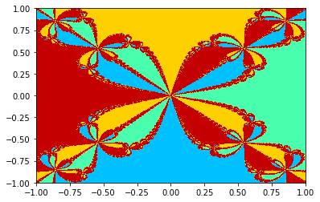
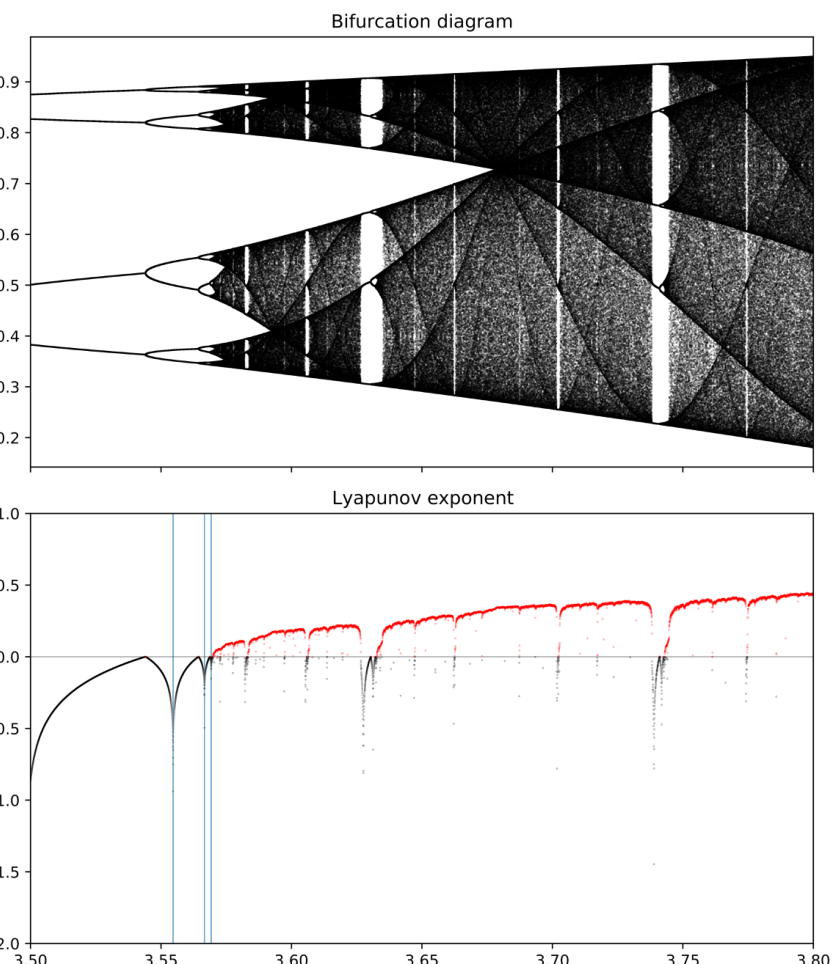

# Dynamical systems, fall 2020: Newton's method, fractals and the logistic map

Short Python programs from a graduate dynamical systems course at Portland State
University, taken in my junior year (October–November 2020; course text: Sternberg,
*Dynamical Systems*). They go with the first written submission for the course,
which is included as LaTeX source and PDF.

> Archived to GitHub in 2026. The code, figures and write-up are unchanged from
> 2020. This README and `docs/` were written in 2026.

  
  

## Programs (`code/`)

| File | What it does |
|---|---|
| `newtons_method.py` | Multivariate Newton's method for the intersection of a plane, a paraboloid and a double cone in ℝ³. Each step solves $J(x_n)\,\Delta x_n = -f(x_n)$ instead of inverting the Jacobian. Starting from (−1, 1, 1), it reaches (−1.3426776, 0.79469667, 1.08223858) to printed precision within five steps. |
| `newton_julia.py` | Newton's method on a grid of complex starting points for $z^4 - 1$, coloured by the argument of the limit, which shows the basins of attraction of the four roots. The $z^3 - 1$ picture came from a variant of the same script. |
| `julia_set_2.py` | An earlier, unfinished experiment toward the same Newton picture, using Pillow and escape-time shading. |
| `mandelbrot.py` | Escape-time rendering of the Mandelbrot set at 1920×1080 with Pillow. |
| `julia_set.py` | The same algorithm with $c$ fixed and $z_0$ varying, which draws filled Julia sets. The figures for other values of $c$ come from editing one line. |
| `superstable.py` | Newton's method in the parameter μ, aimed at the superstable 2ⁿ-periodic orbits of the logistic map $x \mapsto \mu x(1-x)$, i.e. solutions of $f_\mu^{N}(1/2) = 1/2$. See the notes below. |

Requires Python 3 with NumPy, SciPy, Matplotlib and Pillow. Each script runs on its
own: `python code/mandelbrot.py`.

## Figures (`figures/`)

| File | Made by |
|---|---|
| `z3-1.png`, `z4-1.png` | `newton_julia.py` (Newton basins for $z^3-1$ and $z^4-1$) |
| `my_first_brot.PNG` | `mandelbrot.py` |
| `julia.png`, `basilica.png`, `rabbit.png`, `dragon.png`, `dust.png` | `julia_set.py` with $c = -0.7269+0.1889i$, $-1$, $-0.122+0.745i$, $0.360283+0.100376i$, $0.45+0.1428i$ |
| `mandelbrot_correspondence.PNG` | Composite lining up the real axis of the Mandelbrot set with the logistic map's bifurcation diagram |
| `bifurcation.pdf` | Bifurcation diagram and Lyapunov exponent of the logistic map for μ ∈ [3.5, 3.8] (program lost; see below) |
| `newton_surfaces.png` | GeoGebra plot of the three surfaces in `newtons_method.py` |

  

## Write-up (`writeup/`)

`dynamical_systems_submission_1.pdf` is the submission these programs were written
for. It covers:

* the Newton root finder;
* the Newton, Mandelbrot and Julia pictures, with short proofs that the escape radius
  is 2 and that the Mandelbrot set is closed (hence compact);
* the change of variables carrying the logistic family onto $z^2 + c$ for
  $c \in [-2, 1/4]$;
* the superstable-orbit problem;
* a proof of quadratic convergence for Newton's method.

The `.tex` file expects the scripts and figures in the same folder, and it uses a
personal `preamble.sty` that isn't included.

## Notes from 2026

These are things I noticed while archiving the code. The code itself is left as it
was.

* **The bifurcation/Lyapunov and cobweb programs are lost.** Only the 2020 output
  above survives (`bifurcation.pdf`). I believe I wrote them on CoCalc, and that
  account no longer exists.
* **`superstable.py` updates in the wrong order.** It overwrites `x` before using it
  in the derivative recursion $\partial_\mu x_{k+1} = x_k(1-x_k) + \mu(1-2x_k)\,\partial_\mu x_k$,
  so Newton's method gets the wrong slope. That is why the write-up could only
  confirm μ = 2. With the update order swapped, the same scheme converges to
  μ ≈ 3.2360680, 3.4985617, 3.5546409, 3.5666674 and 3.5692435 for periods 2, 4, 8,
  16 and 32. The last three are the vertical lines in the Lyapunov plot. The
  starting value still matters: a root of $f^{4}(1/2) = 1/2$ can also be the period-2
  parameter.
* **The Lyapunov estimate in the write-up** has $x_0$ where the orbit point $x_n$
  belongs, inside $\log\lvert\mu - 2\mu x_n\rvert$.
* **Figure 9's caption guesses its Julia set is connected.** For $c = 0.45 + 0.1428i$
  the orbit of 0 escapes after six steps, so $c$ is outside the Mandelbrot set. That
  makes the Julia set a Cantor set ("dust", as the file name says). The default
  $c = -0.7269 + 0.1889i$ in `julia_set.py` is also just outside: its orbit escapes at
  step 431, beyond the program's 255-iteration cap.
* **`newton_julia.py` uses a 10 000 × 10 000 complex grid.** Each array is about
  1.6 GB, which is why it was slow. Use a smaller `n` to try it.
